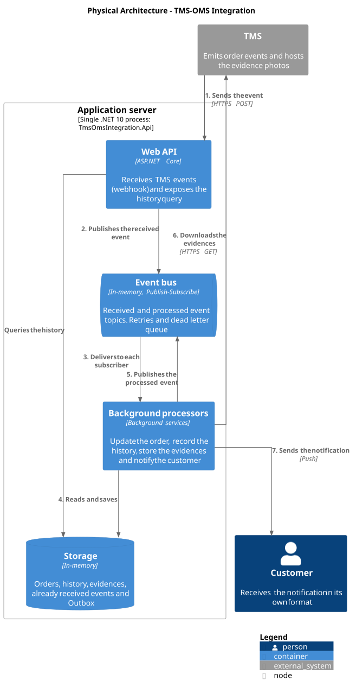
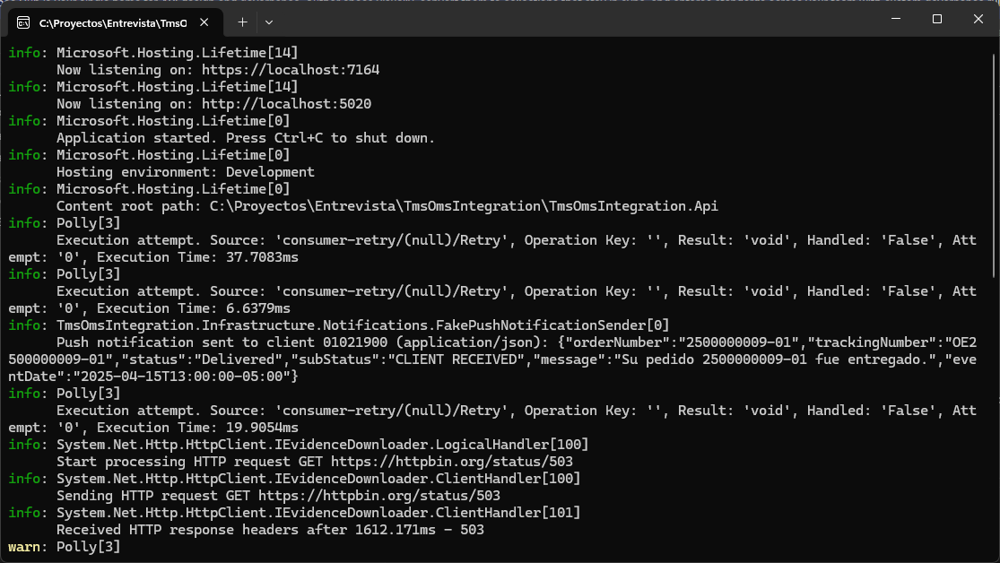

# TMS-OMS Integration

Integration that synchronizes order status between an external **TMS** (for example, Beetrack)
and a logistics company's internal **OMS**, and keeps customers informed about the progress of
their orders.

It receives TMS events via webhook, updates the order in the OMS and, asynchronously and
independently, records the history, stores the evidences and notifies the customer in its own
format, with automatic retries on transient failures.



## Documentation

| Document | Content |
|---|---|
| [Architecture](docs/diagram.md) | Architecture diagrams and component description |
| [Technical decisions](docs/technical-decisions.md) | Pattern justification, interpretations of the requirements, assumptions and limitations |

## Covered requirements

| # | Requirement | Implementation |
|---|---|---|
| 1 | Event reception via webhook | `POST /api/webhooks/tms/events`: API key, payload validation, duplicate discarding and `202 Accepted` response |
| 2 | Order status update | `Order.Apply` rejects events for orders in `DELIVERED` or `RETURNED` |
| 3 | Visit counter | `DELIVERED` and `NOT DELIVERED` add one visit |
| 4 | Return | On the third `NOT DELIVERED`, `TO BE RETURN` is emitted automatically |
| 5 | History log | Append-only history, with both applied and rejected events. `GET /api/orders/{orderNumber}/history` |
| 6 | Evidence storage | At the six milestones, evidences are downloaded and stored per order |
| 7 | Customer notification | One formatter per customer (Strategy) plus a default one |
| 8 | Retry logic | Exponential backoff with jitter, dead letter queue and Outbox |

## Technologies

- **.NET 10** and **ASP.NET Core Web API** with controllers
- **Clean Architecture**: `Domain`, `Application`, `Infrastructure` and `Api` projects
- **`System.Threading.Channels`** as an in-memory Publish-Subscribe bus
- **Polly 8** (`Microsoft.Extensions.Http.Resilience`) for retries
- **In-memory** repositories and storage, as allowed by the requirements: no external service is needed
- **xUnit** for unit tests

## Project structure

```
TmsOmsIntegration.slnx
├── TmsOmsIntegration.Domain          Business rules: Order aggregate and domain events
├── TmsOmsIntegration.Application     Use cases, subscribers and ports (interfaces)
├── TmsOmsIntegration.Infrastructure  Bus, Outbox, retries, repositories, evidences and notifications
├── TmsOmsIntegration.Api             Controllers, input contracts and application composition
├── TmsOmsIntegration.Tests           Unit tests for Domain and Application
└── docs                              Diagrams and technical decisions
```

## How to run it

**Prerequisite:** [.NET 10 SDK](https://dotnet.microsoft.com/download). Visual Studio 2026
already includes it.

The webhook requires an API key in the `X-Api-Key` header. No secret is stored in the repository:
[`appsettings.model.json`](TmsOmsIntegration.Api/appsettings.model.json) shows the expected
structure, and the value is configured with User Secrets. If the API key is not configured, the
application does not start and explains why.

In every case, the API is available at `http://localhost:5020`.

### Option A: Visual Studio 2026

1. Open the `TmsOmsIntegration.slnx` solution.
2. Configure the API key: right-click the `TmsOmsIntegration.Api` project → **Manage User Secrets** and fill in the `secrets.json` that opens:

   ```json
   {
     "TmsWebhook": {
       "ApiKey": "<your-api-key>"
     }
   }
   ```

3. Make sure `TmsOmsIntegration.Api` is the startup project and select the **`http`** profile in the toolbar.
4. Run with **F5** (with debugging) or **Ctrl+F5** (without debugging).
5. Open [`TmsOmsIntegration.Api.http`](TmsOmsIntegration.Api/TmsOmsIntegration.Api.http), replace `<your-tms-webhook-api-key>` with the configured API key and click **Send request** on the request.

> When testing retries with debugging, Visual Studio breaks on every exception that Polly later handles. To see the full flow without interruptions, use **Ctrl+F5**.

### Option B: Visual Studio Code

Requires the [C# Dev Kit](https://marketplace.visualstudio.com/items?itemName=ms-dotnettools.csdevkit)
and [REST Client](https://marketplace.visualstudio.com/items?itemName=humao.rest-client) extensions.

1. Open the repository folder.
2. Configure the API key from the integrated terminal:

   ```bash
   dotnet user-secrets set "TmsWebhook:ApiKey" "<your-api-key>" --project TmsOmsIntegration.Api
   ```

3. Run the API from the terminal:

   ```bash
   dotnet run --project TmsOmsIntegration.Api --launch-profile http
   ```

   Or, to debug, from **Run and Debug** (Ctrl+Shift+D) with the **C#** configuration on the `TmsOmsIntegration.Api` project.

4. Open [`TmsOmsIntegration.Api.http`](TmsOmsIntegration.Api/TmsOmsIntegration.Api.http), replace `<your-tms-webhook-api-key>` with the configured API key and click **Send Request** on the request.

### Option C: command line

```bash
dotnet user-secrets set "TmsWebhook:ApiKey" "<your-api-key>" --project TmsOmsIntegration.Api
dotnet run --project TmsOmsIntegration.Api --launch-profile http
```

Send an event with `curl`:

```bash
curl -X POST http://localhost:5020/api/webhooks/tms/events \
  -H "Content-Type: application/json" \
  -H "X-Api-Key: <your-api-key>" \
  -d '{
    "serviceType": "LAST_MILE",
    "status": "NOT DELIVERED",
    "subStatus": "CLIENT ABSENT",
    "details": { "orderNumber": "2500000007-01" },
    "eventDate": "2025-04-15 10:00:00"
  }'
```

And query the order history:

```bash
curl http://localhost:5020/api/orders/2500000007-01/history
```

The result of each step (notifications, stored evidences, retries and dead-lettered messages) is
shown in the application console.

## Unit tests

The tests cover the business rules and the Application pieces that make their own decisions. They
don't require starting the API or configuring the API key.

| Class under test | What it verifies | Requirements |
|---|---|---|
| `Order` | Rejection of events in `DELIVERED` and `RETURNED` | 2 |
| `Order` | Visit counter and automatic `TO BE RETURN` only on the third `NOT DELIVERED` | 3, 4 |
| `ReceiveTmsEvent` and `TmsEventKey` | Duplicate discarding, key release when publishing fails, and key normalization | 1 |
| `EvidenceMilestoneFilter` | Evidences only at the six milestones, when present, and on applied events | 6 |
| `NotificationFormatterResolver` | Customer formatter, default formatter and configuration errors | 7 |

**Visual Studio 2026:** **Test** menu → **Run All Tests** (Ctrl+R, A). Results are shown in
**Test Explorer** (Ctrl+E, T).

**Visual Studio Code:** with C# Dev Kit, from the **Testing** view (the flask icon) →
**Run Tests**.

**Command line:**

```bash
dotnet test
```

## Endpoints

| Method | Route | Responses |
|---|---|---|
| `POST` | `/api/webhooks/tms/events` | `202` event accepted (also for duplicates) · `400` invalid payload · `401` missing or wrong API key |
| `GET` | `/api/orders/{orderNumber}/history` | `200` order history · `404` the order does not exist in the OMS |

## Test data

The OMS is represented by these orders, loaded at application startup:

| Order | Customer | Notification format |
|---|---|---|
| `2500000006-01` | `01021755` (TIENDAS PERUANAS) | Customer-specific |
| `2500000007-01` | `01021755` (TIENDAS PERUANAS) | Customer-specific |
| `2500000008-01` | `01021800` | Default |
| `2500000009-01` | `01021900` | Default |

All data lives in memory: when the application restarts, orders return to their initial state.

## Test scenarios

| Scenario | How to test it | Expected result |
|---|---|---|
| Automatic return | Three `NOT DELIVERED` on `2500000007-01`, with different `eventDate` values | The history shows three visits and an automatic `TO BE RETURN` |
| Order in final state | A `DELIVERED` followed by a `PLANNING` on `2500000006-01` | The `PLANNING` is recorded in the history as rejected (`FinalState`) |
| Duplicate event | The same event twice | Both return `202`; the second one is discarded |
| Per-customer format | One event on `2500000007-01` and another on `2500000008-01` | Two notifications with different structures in the console |
| Evidences | A `DELIVERED` with one valid evidence URL and one `htps://` | The valid one is stored; the invalid one is skipped without rejecting the event |
| Retries | A `DELIVERED` with the evidence `https://httpbin.org/status/503` | Retries with increasing delays and, finally, the message in the dead letter queue |

Each new event needs a different `eventDate`; otherwise it is discarded as a duplicate.

## See it in action

Console output of the **Retries** scenario. The customer notification is sent right away, while the
evidence download receives a `503` and Polly starts retrying it. Each subscriber has its own
channel, so the failing download does not block the notification.


