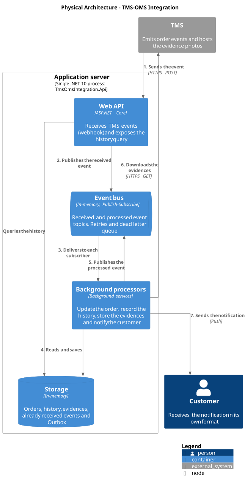
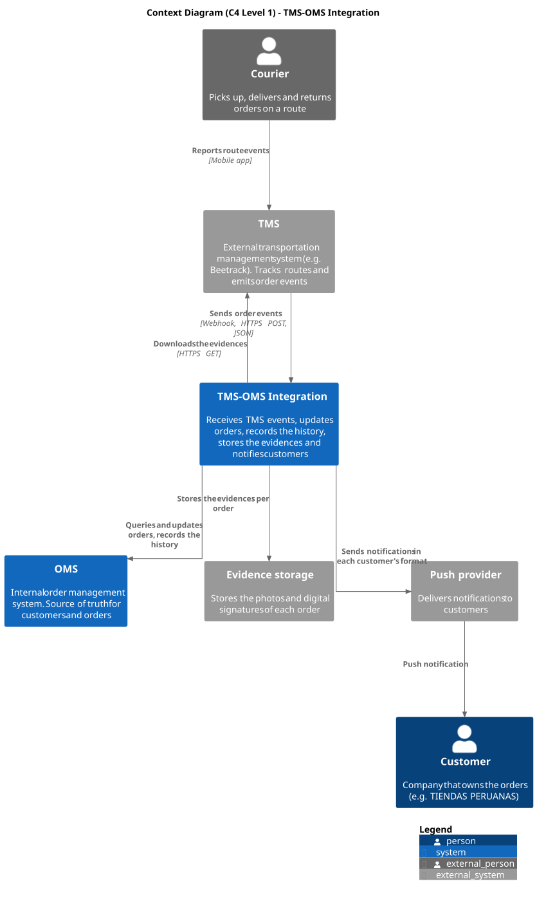
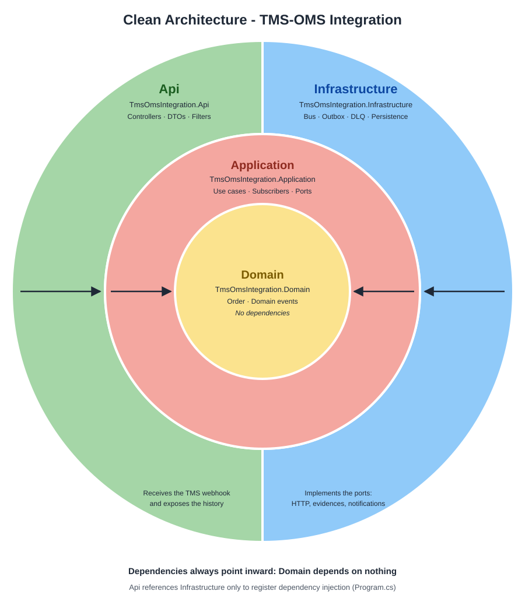
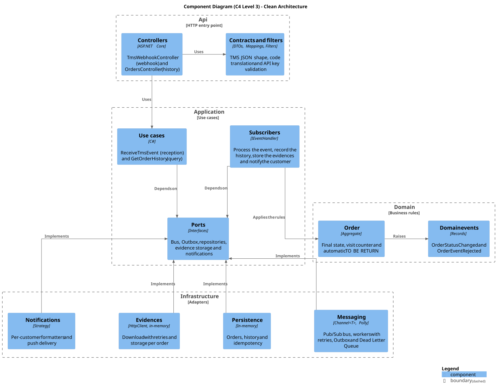

# Architecture - TMS-OMS Integration

The integration synchronizes order status between the external **TMS** and the internal **OMS**.
It receives TMS events via webhook, updates the order in the OMS and, asynchronously and
independently, records the history, stores the evidences and notifies the customer.

This document covers two deliverables of the case:

1. [Architecture Diagram](#1-architecture-diagram)
2. [Component Description](#2-component-description)

The justification of the patterns and the other technical decisions are in
[technical-decisions.md](technical-decisions.md).

The diagrams are generated from the PlantUML sources in [diagrams/](diagrams/). To regenerate them:

```bash
java -jar plantuml.jar -tsvg -charset UTF-8 docs/diagrams/*.puml
```

`clean-architecture.svg` is a hand-written SVG and is edited directly.

---

## 1. Architecture Diagram

The architecture is presented in four views, from the most concrete to the most internal:

| View | Answers |
|---|---|
| [1.1 Physical architecture](#11-physical-architecture) | Where does the system run and how does an event flow? |
| [1.2 Context](#12-context-c4-level-1) | Which systems and people does it communicate with? |
| [1.3 Clean Architecture](#13-clean-architecture) | How is the code organized? |
| [1.4 Components](#14-components-c4-level-3) | Which pieces exist in each layer and how do they depend on each other? |

### 1.1 Physical architecture

Shows the system's **artifacts** as it runs today and the **communication flows** between them,
numbered in the order they occur.



| Step | Flow | Description |
|---|---|---|
| 1 | TMS → Web API | The TMS sends the event via webhook. The API validates the API key and the payload, discards duplicates and responds `202 Accepted` |
| 2 | Web API → Event bus | The event is published to the received-events topic |
| 3 | Bus → Processors | The bus delivers a copy of the event to each subscriber |
| 4 | Processors → Storage | The event is applied to the order (status, visits, return) and the result is saved together with the Outbox |
| 5 | Processors → Event bus | The Outbox publishes the processed event to the second topic |
| 6 | Processors → TMS | At milestones with evidences, photos and signatures are downloaded from the TMS |
| 7 | Processors → Customer | The notification is sent in each customer's own format |

From step 5 onwards, the three side effects (history, evidences and notification) run
**in parallel**, each with its own retries: a failure in one does not stop the others.

Source: [`deployment.puml`](diagrams/deployment.puml)

### 1.2 Context (C4 Level 1)

Shows the integration as a single box and the systems and people it communicates with. In blue,
what belongs to the company; in gray, what is external.



Source: [`context.puml`](diagrams/context.puml)

### 1.3 Clean Architecture

The code is organized in four projects. Dependencies always point toward the center: the domain
contains the business rules and depends on nothing.



| Layer | Project | Depends on |
|---|---|---|
| Domain | `TmsOmsIntegration.Domain` | Nothing |
| Application | `TmsOmsIntegration.Application` | Domain |
| Infrastructure | `TmsOmsIntegration.Infrastructure` | Application |
| Api | `TmsOmsIntegration.Api` | Application and Infrastructure (only to register dependency injection in `Program.cs`) |

### 1.4 Components (C4 Level 3)

Shows the pieces of each layer and their dependencies. Application defines the **ports**
(interfaces) and Infrastructure **implements** them: this way, changing a technology (for
example, the in-memory bus for a message broker) does not affect Application or Domain.



Source: [`components.puml`](diagrams/components.puml)

---

## 2. Component Description

### 2.1 External systems and people

| Component | Role |
|---|---|
| **Courier** | Person who picks up, delivers and returns orders. Reports every route event in the TMS |
| **TMS** | External transportation management system (for example, Beetrack). Emits order events via webhook and hosts the evidence photos and signatures |
| **OMS** | Internal order management system. The source of truth for customers and orders |
| **Evidence storage** | Stores the digital evidences of each order, organized by order number |
| **Push provider** | Delivers notifications to each customer |
| **Customer** | Company that owns the orders. Receives notifications in its own structure |

### 2.2 Physical architecture artifacts

| Component | Role |
|---|---|
| **Application server** | A single .NET 10 process (`TmsOmsIntegration.Api`) that contains the API, the bus, the processors and the storage |
| **Web API** | HTTP entry point. Receives the TMS webhook, responds quickly with `202 Accepted` and exposes the history query |
| **Event bus** | In-memory Publish-Subscribe messaging with two topics: received events and processed events. Each subscriber has its own channel, with retries and a dead letter queue |
| **Background processors** | Consume the topics: update the order, record the history, store the evidences and notify the customer. They also publish the Outbox |
| **Storage** | Orders, history, evidences, keys of already received events and pending Outbox messages |

### 2.3 Components per layer

#### Api

| Component | Role |
|---|---|
| **TmsWebhookController** | `POST /api/webhooks/tms/events` endpoint. Delegates to the reception use case and responds `202` for duplicates too, so the TMS stops resending them |
| **OrdersController** | `GET /api/orders/{orderNumber}/history` endpoint. Returns the order history, or `404` if the order does not exist in the OMS |
| **Contracts and filters** | `TmsEventRequest` mirrors the TMS payload and validates it. `TmsCodes` translates TMS values (for example, `"AT PICKUP POINT"`) into domain enums. `TmsEventDateConverter` parses the TMS date format. `ApiKeyAuthFilter` validates the `X-Api-Key` header with a constant-time comparison |

#### Application

| Component | Role |
|---|---|
| **ReceiveTmsEvent** | Computes a key per event (the TMS does not send an identifier), discards duplicates and publishes the received event. If publishing fails, it releases the key so the TMS resend is not lost |
| **ProcessTmsEventHandler** | Subscriber of the received-events topic. Finds the order, applies the event and puts the result in the Outbox before saving the order |
| **RecordHistoryHandler** | Records every processed event in the history, both applied and rejected ones |
| **StoreEvidencesHandler** | Only at the six milestones with evidences (`COLLECTED`, `NOT COLLECTED`, `DELIVERED`, `NOT DELIVERED`, `RETURNED`, `NOT RETURNED`): downloads each evidence and stores it linked to the order. An invalid URL is skipped without stopping the event |
| **NotifyClientHandler** | Gets the customer from the OMS, picks its formatter and sends one notification per status change. Rejected events are not notified |
| **GetOrderHistory** | History query use case |
| **Ports** | Interfaces that Application needs and Infrastructure implements: event bus, Outbox, dead letter queue, repositories, evidence download and storage, notification formatting and sending |

#### Domain

| Component | Role |
|---|---|
| **Order** | Order aggregate. The only place where its status changes: rejects events if the order is already `DELIVERED` or `RETURNED`, adds a visit on each `DELIVERED` or `NOT DELIVERED`, and automatically emits `TO BE RETURN` when the third visit is a `NOT DELIVERED` |
| **Domain events** | `OrderStatusChanged` (the order changed status, with a flag if the change was automatic) and `OrderEventRejected` (the event was rejected, with its reason) |

#### Infrastructure

| Component | Role |
|---|---|
| **Messaging** | `ChannelEventBus` fans out each message to every subscriber's channel. `SubscriberWorker` consumes each channel with three retries using exponential backoff, and sends whatever exhausts the retries to the dead letter queue. `OutboxDispatcher` publishes pending messages and only removes them from the Outbox after publishing them |
| **Persistence** | In-memory repositories for orders (with test data representing the OMS) and history (append-only, never modified). Key store for discarding duplicate events |
| **Evidences** | `HttpEvidenceDownloader` downloads each evidence via streaming, with retries using exponential backoff and jitter, plus per-attempt and total timeouts. `InMemoryEvidenceStorage` stores them under the path `orders/{order}/{file}` |
| **Notifications** | A default formatter and one specific to customer `01021755`, each with its own message structure. `FakePushNotificationSender` simulates the push delivery by writing the notification to the log |

### 2.4 Current implementation and evolution

As allowed by the case, external services are replaced by in-memory implementations. Thanks to the
ports, each one can be swapped for a real service without modifying Application or Domain.

| Component | Current implementation | Production evolution |
|---|---|---|
| Event bus | In-memory `Channel<T>` | Durable message broker with topics, subscriptions and a native dead letter queue |
| Orders, history and Outbox | In-memory dictionaries | OMS database, with the order and the Outbox in the same transaction |
| Idempotency keys | In-memory dictionary, no expiration | Distributed cache with expiration |
| Evidence storage | In-memory dictionary | Object storage with private access |
| Push delivery | Writing to the log | Push notification provider or each customer's webhook |
| Webhook API key | User Secrets | Secrets manager |
